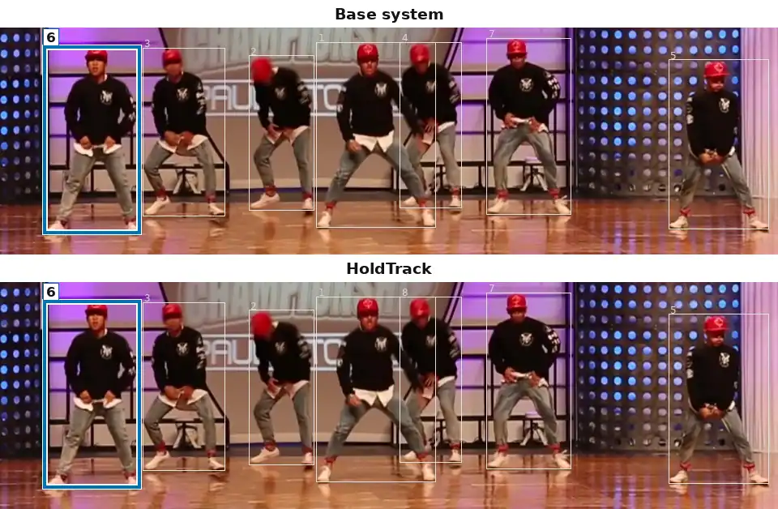
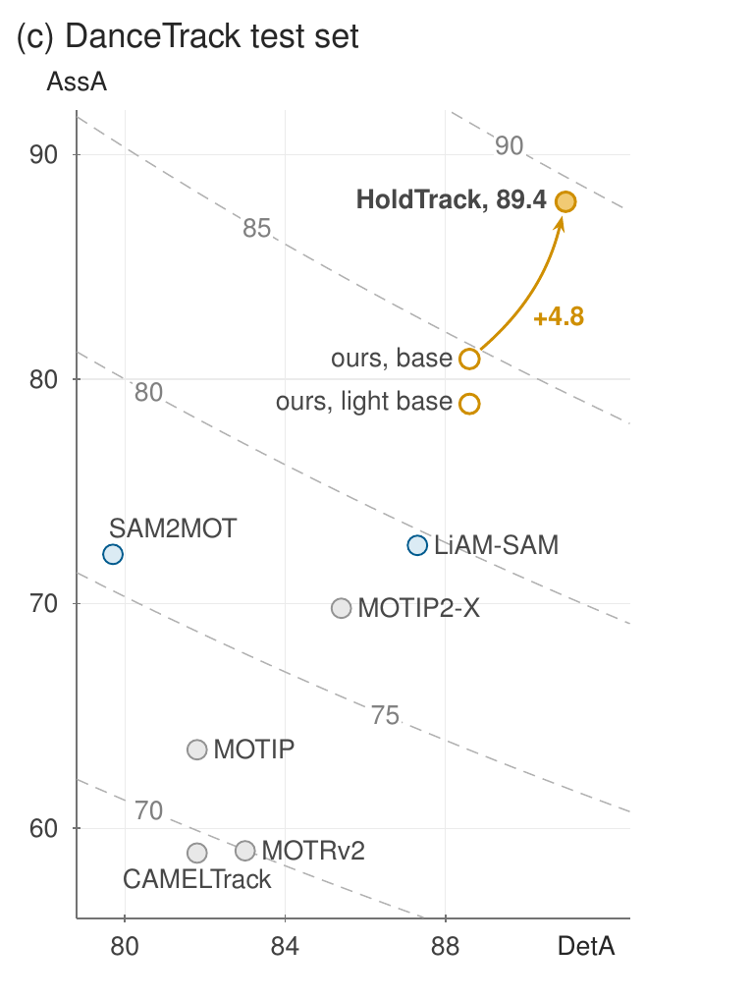
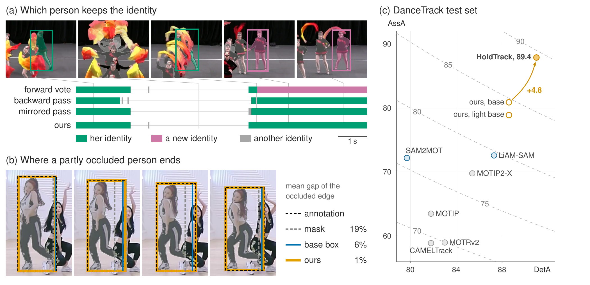

<div align="center">

# HoldTrack

**Two decisions at contact in multi-person tracking**

**89.4 HOTA on the DanceTrack test set**, with 91.0 DetA, 87.9 AssA, 96.4 MOTA and 94.8 IDF1

[Paper (PDF)](https://tofboubou.github.io/HoldTrack/HoldTrack.pdf), arXiv link coming soon | [Project page](https://tofboubou.github.io/HoldTrack/) | [Weights](https://huggingface.co/TheophaneBourdon/HoldTrack) | [Run it](#run-it-on-your-video) | [Test outputs](results/test35/) | [Citation](#citation)



<sub>One scene of DanceTrack (<code>dancetrack0037</code>, 5 s to 16 s). Top: the forward vote of the base system. Bottom: HoldTrack, on the same boxes. The thick box follows one dancer, with the color and the number of the identity she carries. In the base system she becomes 8 after a contact, then 2, the number of another dancer. In HoldTrack she is 6 again after each contact.</sub>



</div>

## Run it on your video

```bash
holdtrack track clip.mp4
```

writes `clip_holdtrack/tracks.txt` (one row per box: frame, identity, left, top, width, height), `clip_holdtrack/masks/` and `clip_holdtrack/tracks.mp4`, the video with one color per identity.

By default the command runs the light base system, with one detector and one SAM 3 pass. It scores 83.6 HOTA on the DanceTrack test set and runs at 2.2 frames per second on one RTX 5080. With `--full`, it runs HoldTrack without its face steps (87.9 HOTA): five detector views, five tracker passes, the corrected boxes and the identity chain, at 5.4 seconds per frame on one A40 ([docs/FULL.md](docs/FULL.md)). `--full --faces` adds the face steps and reaches 89.4 HOTA. You download the two face models yourself ([docs/FACES.md](docs/FACES.md)).

## Two decisions at contact

A strong tracker built on SAM 3 still loses points on DanceTrack, and about three quarters of what oracle corrections recover is lost when dancers touch.
At each contact, HoldTrack makes two decisions, from several models run over the whole video.

- **Which person keeps an identity.** A chain of 21 steps combines faces, appearance, position and tracker passes that differ in memory update, in temporal direction or by mirroring. These cues err in different ways. When two forward passes are wrong on the same box, they pick the same wrong person 22.9% of the time, and a forward and a backward pass only 9.9% of the time. Ten steps change an identity only when two cues agree, ten act on a single cue under a condition on the identities, and one is a learned link classifier.
- **Where the box of a partly occluded person ends.** DanceTrack annotates the full extent of every person, including the parts hidden by another dancer. A small corrector learns it from the outputs of detectors, pose estimators, a 3D body mesh and the tracker masks. The tracker itself is not fine-tuned.



## Results

DanceTrack test set. † marks methods that also train on the validation set. Our rows run offline.

| Method | HOTA | DetA | AssA | MOTA | IDF1 |
|:--|:-:|:-:|:-:|:-:|:-:|
| ByteTrack | 47.7 | 71.0 | 32.1 | 89.6 | 53.9 |
| SUSHI (offline) | 63.3 | 80.1 | 50.1 | 88.7 | 63.4 |
| MOTRv2 | 69.9 | 83.0 | 59.0 | 91.9 | 71.7 |
| MOTIP | 72.0 | 81.8 | 63.5 | 91.9 | 76.8 |
| SAM2MOT | 75.8 | 79.7 | 72.2 | 88.5 | 83.9 |
| MOTIP2-X † | 77.1 | 85.4 | 69.8 | 93.3 | 81.2 |
| LiAM-SAM, RF-DETR | 79.6 | 87.3 | 72.6 | 94.3 | 83.6 |
| *Ours, without the two decisions* | | | | | |
| Light base system † | 83.6 | 88.6 | 78.9 | 95.7 | 89.1 |
| Base system † | 84.6 | 88.6 | 80.9 | 95.9 | 90.4 |
| *Ours, with the two decisions* | | | | | |
| HoldTrack, no face model † | 87.9 | 90.7 | 85.1 | 96.4 | 92.8 |
| **HoldTrack** † | **89.4** | **91.0** | **87.9** | **96.4** | **94.8** |

Rows of other trackers are copied from each paper. The 35 files in [`results/test35/`](results/test35/) are the test outputs of HoldTrack, and submitted to the benchmark server they give 89.4 HOTA.

On the test set, each decision also helps alone.

| | HOTA | DetA | AssA |
|:--|:-:|:-:|:-:|
| Base system | 84.6 | 88.6 | 80.9 |
| + corrected boxes | 86.2 | 90.5 | 82.1 |
| + identity chain | 87.8 | 89.2 | 86.5 |
| Both (HoldTrack) | **89.4** | **91.0** | **87.9** |

The same corrected boxes raise the light base system from 83.6 to 85.2 HOTA, as much as they raise the base system. Without any face model, HoldTrack still scores 87.9.

## Pieces for your tracker

Each piece is a module of the package with its own entry point, so you can use it in another tracker.

- **Agreement of a backward and a mirrored pass** ([`holdtrack.identity.agree`](holdtrack/identity/agree.py), [docs](docs/AGREEMENT.md)). Two more passes of a SAM 2 or SAM 3 tracker, one backward in time and one on the mirrored video, correct the identities of the forward pass where both agree against it. It needs no training and no face model, and adds 0.93 HOTA to one SAM 3 pass and 0.50 to our base system on the 57 annotated videos of DanceTrack.
- **The identity chain** ([`holdtrack.identity`](holdtrack/identity/), [docs](docs/IDENTITY.md)), in its twelve steps without faces. Started from ByteTrack identities on our boxes, it takes the 57 annotated videos from 58.8 to 82.8 HOTA.
- **The box corrector** ([`holdtrack.boxes`](holdtrack/boxes/), [docs](docs/BOXES.md)) moves each box edge toward the full extent of the person, from the outputs of frozen models. On the test set it raises the light base system from 83.6 to 85.2 HOTA and the base system from 84.6 to 86.2. It also works on the tracks of a published tracker. On OC-SORT (53.9 HOTA in our replay), it keeps the same rows and identities and raises HOTA to 55.6 and DetA from 80.1 to 83.5. The corrector reads the masks of the three forward SAM 3 passes.
- **Identity at the return of a person, and track finishing** ([`holdtrack.identity.returns`](holdtrack/identity/returns.py), [`holdtrack.steps.finishing`](holdtrack/steps/finishing.py), [docs](docs/MOT17.md)). These steps are for street videos. An identity that comes back after an absence is cut when the person could not have reached that place. A classifier fitted on pairs made from the tracks themselves then links the tracklets again. Tracks also start earlier from the masks of the passes, gaps are filled under camera motion and box edges are smoothed. None of these steps reads an annotation. On held-out MOT17 training videos, the return step raises HOTA from 57.6 to 58.4, the earlier start from 58.4 to 59.5 and the smoothing from 63.0 to 63.7.
- **The exclusive memory update** for SAM 3, without training ([`holdtrack/sam/memory.py`](holdtrack/sam/memory.py), `MemoryPolicy`). A pixel covered by several masks is stored only in the memory of the mask with the highest logit.
- **Two analysis tools** ([`holdtrack.analysis`](holdtrack/analysis/), [docs](docs/ANALYSIS.md)). The first shows where a tracker loses HOTA, split between identities, boxes, missed persons and false boxes, at contact and away from it. The second measures whether several passes of a tracker make the same identity errors.

## Reproduce our numbers

The scripts of [`research/replays/`](research/replays/) run the package on the stored outputs of the models, on a CPU, and compare with the frozen system.

| Replay | Result |
|:--|:--|
| [`chain_test35.py`](research/replays/chain_test35.py) | from the model outputs to the final tracks of the 35 test videos: byte-identical to the submission without faces (87.9 HOTA) |
| [`faces_chain_test35.py`](research/replays/faces_chain_test35.py) | the face steps, the relay and the assembly on the 35 test videos: byte-identical to the submission of the complete system (89.4 HOTA) |
| [`identity_steps_test.py`](research/replays/identity_steps_test.py), [`identity_steps_annotated57.py`](research/replays/identity_steps_annotated57.py) | the identities after each step of the chain, on the test set and on the 57 annotated videos: no row differs |
| [`identity_agree.py`](research/replays/identity_agree.py) | the agreement module alone |
| `holdtrack track --full`, from the pixels, on a rented A40 | one test video of 603 frames: 3,008 of the 3,009 rows of the submission without faces, each with the same identity, 98.0% of the boxes within one pixel |
| `holdtrack track`, from the pixels, on a rented A40 | the same video with the light system: the same identity on every row as its frozen output, boxes within 0.03 pixel (median) |
| [`faces_second_eye.py`](research/replays/faces_second_eye.py) | the second face model on 92 videos: the six outputs are identical |
| `holdtrack.faces`, from the frames and the poses, on a rented A40 | two test videos, the two face models fetched from their authors: the same identity on every row as the submission |
| [`mot17_test.py`](research/replays/mot17_test.py) | the steps after the box corrector on the seven MOT17 test videos: the 14 files of the submission, byte-identical |
| `python -m holdtrack.boxes.training`, on the stored tables | the MOT17 box corrector, its trees fitted again and averaged with its four networks: started from its boxes, the replay writes the 14 files of the submission byte-identical |
| [`analysis_where_lost.py`](research/replays/analysis_where_lost.py), [`analysis_shared_errors.py`](research/replays/analysis_shared_errors.py) | the two analyses of the paper |

## Repository

| Folder | Content |
|:--|:--|
| [`holdtrack/`](holdtrack/) | The package: `track` (one command), `sam` (SAM 3 passes and memory updates), `pipeline` (vote, detector fusion, track-level steps), `boxes` (box corrector), `identity` (identity chain), `faces`, `analysis`, `render`. |
| [`docs/`](docs/) | One page per part: the complete system, the box corrector, the identity chain, the agreement module, faces, analysis, SAM passes, detector training, MOT17, reproduction. |
| [`research/replays/`](research/replays/) | Replays of the package against the frozen system. |
| [`results/`](results/) | Test outputs of HoldTrack: the 35 files of the test set. |

## Getting started

```bash
pip install -e ".[sam,detect,identity,eval]"     # Python 3.12, one 16 GB GPU
python -m holdtrack.fetch_models --weights-dir weights   # fetch and verify the models (--full: complete system)
holdtrack track clip.mp4                         # light system: tracks, masks, video
holdtrack track clip.mp4 --full                  # complete system, without faces
holdtrack track clip.mp4 --full --faces          # complete system
holdtrack evaluate --tracks tracks.txt --gt gt/gt.txt --out metrics.json
```

The weights of HoldTrack are on [Hugging Face](https://huggingface.co/TheophaneBourdon/HoldTrack). SAM 3 and SAM 3D Body come from their authors, once you accept their licenses there. [docs/REPRODUCE.md](docs/REPRODUCE.md) lists the model files and every configuration, [docs/FULL.md](docs/FULL.md) the stages, models and environments of the complete system, and [docs/TRAINING.md](docs/TRAINING.md) the training of the detectors.

## Roadmap

HoldTrack is under active development: new results, weights and features will be added here.

- The stored model outputs that the replays read, on Hugging Face with checksums. Face embeddings will not be distributed, and the replays of the face steps compute them again with the models of their authors.
- A Colab notebook and a demo to run HoldTrack on your own video.
- DanceTrack-Hard: the hardest annotated videos as a separate benchmark, with an evaluation script.

## Contact

HoldTrack is developed by Théophane Bourdon. For questions, collaborations or opportunities in multi-object tracking and video understanding, write to theophane.bourdon@ensta.fr. Bug reports and pull requests are welcome.

## Citation

```bibtex
@misc{bourdon2026holdtrack,
  title  = {HoldTrack: Two Decisions at Contact in Multi-Person Tracking},
  author = {Bourdon, Th{\'e}ophane},
  year   = {2026},
  note   = {arXiv preprint, link coming soon}
}
```

## License

Code under [Apache-2.0](LICENSE). Models and fonts keep their upstream licenses, listed in [LICENSES](LICENSES/). Face embeddings are compared only within a video, and the two face models are not redistributed.
